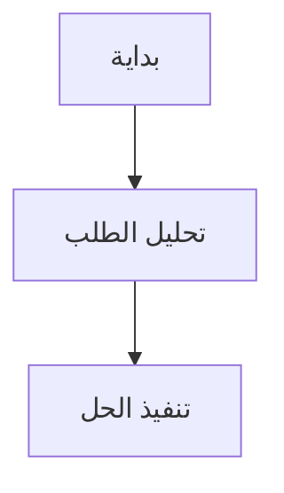

# AI Agent Gateway

مساحة الوكلاء موجودة في المسار `/ai-workspace` وهي محمية للمشرفين. الواجهة لا تضع أي مفتاح سري في المتصفح؛ كل الاتصال يمر عبر Edge Function باسم `multi-agent-chat`.

## تشغيل بوابة الوكلاء

اضبط الأسرار في بيئة Supabase Edge Functions:

```text
AZ_AGENT_GATEWAY_URL=https://your-agent-gateway.example.com/v1
AZ_AGENT_GATEWAY_KEY=server-side-secret
```

بدون `AZ_AGENT_GATEWAY_URL` ترفض الدالة الطلب برسالة إعداد واضحة؛ لا توجد خدمة ذكاء اصطناعي خارجية أو fallback داخل المشروع.

## عقد الطلب

تستدعي الدالة endpoint التالي لكل وكيل مختار:

```http
POST {AZ_AGENT_GATEWAY_URL}/agents/{agent_id}/chat
Authorization: Bearer <AZ_AGENT_GATEWAY_KEY>
Content-Type: application/json
```

```json
{
  "agent_id": "az-agent-project",
  "model": "GPT-5.6-Sol",
  "messages": [
    {"role": "user", "content": "حلل حالة المشروع"}
  ],
  "tools": ["File Search", "A2A Agent Connections"]
}
```

ويجب أن يعيد الخادم JSON يحتوي على واحد من الحقول التالية:

```json
{"content": "..."}
```

أو:

```json
{"response": "..."}
```

أو:

```json
{"output": "..."}
```

## المخططات داخل الدردشة

عند طلب مخطط، يجب أن يعيد الوكيل الكود داخل كتلة Markdown بهذه الصيغة:

````markdown

````

واجهة `/ai-workspace` تكتشف كتل `mermaid` تلقائيًا، وترسمها عبر مكتبة Mermaid في المتصفح باستخدام `securityLevel: strict`. عند فشل الرسم يظهر كود Mermaid للمراجعة وإعادة التوليد.

## قواعد الأمان

- لا تضع `AZ_AGENT_GATEWAY_KEY` أو مفاتيح Azure/Ollama في `.env` الخاص بالواجهة.
- لا ترسل service-role key إلى المتصفح.
- يجب على البوابة تطبيق المصادقة، التحقق من الوكيل والأداة، والـ rate limiting.
- الدالة تسمح بحد أقصى 5 وكلاء و20 أداة في الطلب.
- الوكلاء غير الموجودين في السجل المعتمد يتم رفضهم.

## التكاملات المستقبلية

يمكن لبوابة واحدة تنفيذ المحولات التالية دون تغيير واجهة الموقع:

- Azure AI Foundry وA2A Agent Connections.
- Ollama للنماذج المحلية.
- MCP toolboxes.
- Azure AI Search وVision وDocument Intelligence.
- Daftra وWhatsApp وMagicplan وUberFix.
